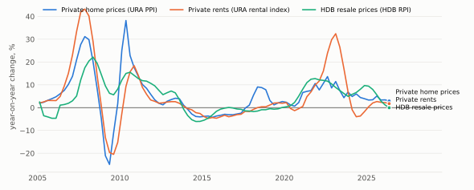

# sgmacro

[English](README.md) · [简体中文](README.zh-CN.md)

A data and reporting tool for Singapore housing research, with every source and
figure open to checking.

sgmacro collects housing and economic data from SingStat and data.gov.sg, flags
gaps, stale series and differences in definitions, and produces charts,
analytical tables and a report. Its sample report carries 340 figures, each with
an ID that leads to the source data or the calculation behind it.

Year-on-year change in the three indices, from 2005 to the second quarter of 2026,
using URA and HDB data from data.gov.sg.

## Housing prices and rents

The project covers three housing indices and thirteen candidate predictors.
It prepares data for housing research; it does not fit a forecasting model.

| Housing index | What it covers |
| --- | --- |
| URA private residential property price index | Private sales, all residential |
| URA private residential rental index | Non-landed private rents, whole island |
| HDB resale price index | Resale flats in public housing |

The report shows index levels, quarterly and annual changes, and annual changes
after adjusting for inflation. This makes it possible to compare price and rental
movements without treating them as the same market.

## The wider picture

The candidate predictors cover financing costs, bond yields, housing credit, GDP,
unemployment, inflation, transactions, inventory, vacancy, construction,
population and housing policy.

Each comes with an explanation of why it may matter for housing, its data source
and its limitations. Researchers can see the latest change alongside its history
and explore its relationship with prices and rents.

The report presents sales and rental commentary separately. It also shows where
the economic interpretation is uncertain.

## Figures you can inspect

Readers can check any figure's period, source and calculation in the report,
rather than relying on an unexplained chart or summary.

Alongside the charts, the report shows data-quality findings and source
comparisons. Missing observations, stale series and differences in definitions
stay visible, so researchers can judge whether the data suits their question.

The project also produces analytical tables for further research.

## Research assistance

Optional language-model support helps researchers explore candidate variables,
find possible replacement data sources and draft a plain-language summary of the
report.
Local models are supported through Ollama.

Candidate proposals include source information and an economic explanation for
review. A proposal is not evidence that a variable can predict housing prices.

## Scope and limits

The charts and report describe observed data. The predictors' forecasting value
has not been established with out-of-sample forecasts.

Historical figures may include later revisions, so they do not always show what
was known at the time. Housing policy is recorded by hand and does not capture
how strong each measure was. HDB rents and regional housing price indices are
outside the current coverage.

## Data

Data comes from [data.gov.sg](https://data.gov.sg/) and
[SingStat Table Builder](https://tablebuilder.singstat.gov.sg/), under the
[Singapore Open Data Licence](https://data.gov.sg/open-data-licence) and
[SingStat's Terms of Use](https://www.singstat.gov.sg/terms-of-use).

Original publishers include the Urban Redevelopment Authority (URA), Housing &
Development Board (HDB), Monetary Authority of Singapore, Ministry of Manpower and
Singapore Department of Statistics.

The processed figures, calculations and commentary are the project's own and
should not be attributed to the data publishers. No government agency endorses
this project. Third-party notices are in [LICENSE](LICENSE).

## License

All rights reserved; see [LICENSE](LICENSE). The source code is not public.

Developed by shyfox-01.
