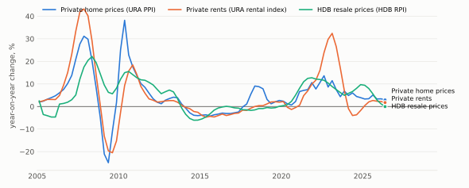

# sgmacro

[English](README.md) · [简体中文](README.zh-CN.md)

用于新加坡住房研究的数据整理与报告工具，数据来源和报告数值均可核查。

sgmacro 汇集 SingStat 和 data.gov.sg 的住房及宏观经济数据，标出缺失值、停更序列和统计口径差异，生成图表、分析表格和报告。示例报告中有 340 项带编号的结果，每一项都能查到来源数据或计算方法。

三项住房指数的同比变化，2005 年至 2026 年第二季度，数据来自 data.gov.sg 上 URA 和 HDB 发布的指数。

## 住房价格与租金

项目覆盖 3 个住房指数和 13 个候选预测变量，为住房研究准备数据，本身不建立预测模型。

| 住房指数 | 覆盖范围 |
| --- | --- |
| URA 私人住宅价格指数 | 私宅售价，全部住宅类型 |
| URA 私人住宅租金指数 | 全岛非有地私宅租金 |
| HDB 组屋转售价格指数 | 组屋转售交易 |

报告展示指数水平、季度环比、同比变化，以及扣除通胀后的同比变化，方便研究者分别观察买卖市场与租赁市场的走势。

## 相关经济环境

候选变量覆盖融资成本、债券收益率、住房信贷、GDP、失业率、通胀、成交量、库存、空置率、在建供应、人口和住房政策。

每个变量都说明了它可能影响住房市场的原因、数据来源和局限。研究者可以将最新变化放回历史背景中观察，并探索它与房价、租金之间的关系。

报告分别讨论买卖市场和租赁市场，并标出经济解释尚不确定的地方。

## 可以核查的数值

读者可以在报告中查看每个数值的时期、出处和计算过程，而不必只看一张没有解释的图表或摘要。

报告还展示数据质量问题和来源对照结果。缺失值、停止更新的序列和统计口径差异都会在报告中标明，便于研究者判断数据是否适用。

项目同时提供可用于后续研究的分析表格。

## 研究辅助

可选的大模型功能可以帮助研究者寻找候选变量、查找替代数据源，并生成报告摘要。项目支持通过 Ollama 使用本地模型。

模型提出的候选变量都附有来源信息和经济解释，供研究者审核。提出一个候选变量，并不意味着它已被证明能够预测房价。

## 范围与局限

图表和报告只描述已观测到的数据；候选变量的预测价值尚未经过样本外预测检验。

历史数据可能含有事后修订，不一定是当时可得的信息。住房政策信息由人工整理，无法反映每项措施的实际力度。覆盖范围不包括组屋租金和分区域的住房价格指数。

## 数据来源

数据来自 [data.gov.sg](https://data.gov.sg/) 和 [SingStat Table Builder](https://tablebuilder.singstat.gov.sg/)，适用 [Singapore Open Data Licence](https://data.gov.sg/open-data-licence) 及 [SingStat 使用条款](https://www.singstat.gov.sg/terms-of-use)。

原始发布机构包括新加坡市区重建局（URA）、建屋发展局（HDB）、新加坡金融管理局、人力部和新加坡统计局。

处理后的数值、计算结果和评论均出自本项目，不代表原始数据发布机构的观点；本项目也未获任何政府机构认可。第三方声明见 [LICENSE](LICENSE)。

## 许可

保留所有权利，详见 [LICENSE](LICENSE)。源码不公开。

作者：shyfox-01。
