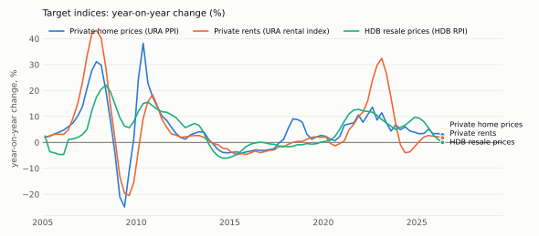
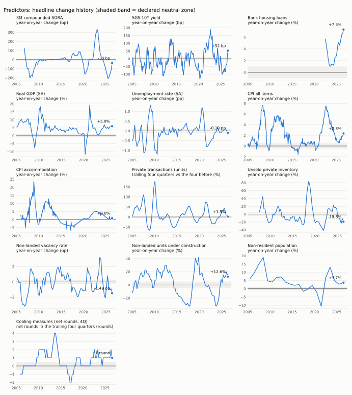

# Singapore residential prices and rents: predictor data report

**As-of date:** 2026-10-02 · **Run:** `2026-10-02_d26e13cf` · **Registry:** v4 (`23070f0a26ef`) · **Pipeline:** 2.1.0

3 target indices and 13 predictors reported ·
3/3 negative controls rejected exactly as expected ·
340 figures, each with a fact id; `sgmacro trace <id> --run 2026-10-02_d26e13cf` re-reads the raw cells behind any level or change and recomputes it.

Only observations that could have been published by 2026-10-02 are used: each is admitted once its
reference date plus the declared publication lag has passed. Rates and ratios change in percentage points or
basis points, never in percent. Nothing here is a forecast; no model is fitted.

## 1. Summary

### Sales

- Private home prices rose on a year-on-year basis while real price growth also advanced. HDB resale prices held steady nominally but declined in real terms.
  <sub>Private home prices (URA PPI), year-on-year change +2.9%, 2026 Q2 `F:06cca86b` · Private home prices (URA PPI), real (CPI-deflated) year-on-year change +1.0%, 2026 Q2 `F:f0c465dd` · HDB resale prices (HDB RPI), year-on-year change 0.0%, 2026 Q2 `F:263a825a` · HDB resale prices (HDB RPI), real (CPI-deflated) year-on-year change -1.9%, 2026 Q2 `F:533960e6`</sub>
- Lower mortgage financing costs, higher bank housing loans, stronger economic activity, reduced labour market slack, rising realised housing costs, falling developer inventory, tighter supply slack, and growing non-resident population all support sales. These factors reflect improved affordability, credit availability, income growth, and constrained supply relative to demand.
  <sub>3M compounded SORA, year-on-year change -38 bp, Aug 2026 `F:331a4bda` · Bank housing loans, year-on-year change +7.3%, Aug 2026 `F:a589ed7d` · Real GDP (SA), year-on-year change +5.9%, 2026 Q2 `F:605ceea6` · Unemployment rate (SA), year-on-year change -0.10 pp, 2026 Q2 `F:0681d341` · CPI accommodation, year-on-year change +0.8%, Aug 2026 `F:9f9ea43e` · Unsold private inventory, year-on-year change -19.3%, 2026 Q2 `F:623df940` · Non-landed vacancy rate, year-on-year change -1.49 pp, 2026 Q2 `F:94768f7b` · Non-resident population, year-on-year change +3.7%, 2026 `F:0fbbb3a9`</sub>
- Higher long-horizon discount rates, increased forward supply, and tighter housing policy act as headwinds to sales. These movements suggest elevated borrowing costs for long-term financing, greater future inventory pressure, and restrictive regulatory conditions.
  <sub>SGS 10Y yield, year-on-year change +52 bp, Aug 2026 `F:c145ab14` · Non-landed units under construction, year-on-year change +12.6%, 2026 Q2 `F:9bb1195d` · Cooling measures (net rounds, 4Q), net rounds in the trailing four quarters +1 round, 2026 Q3 `F:0fb21029`</sub>
- Market activity showed little change in its trailing four-quarter comparison. This indicates that transaction volumes have barely moved relative to the prior period.
  <sub>Private transactions (units), trailing four quarters vs the four before +1.9%, 2026 Q2 `F:cc8b57d8`</sub>
- The general price level movement provides no clear directional signal for sales. Theory offers no definitive sign on how this inflation measure bears on the market under current conditions.
  <sub>CPI all items, year-on-year change +2.3%, Aug 2026 `F:18a45b38`</sub>

### Rents

- Private rents rose nominally over the year but fell in real terms after adjusting for inflation.
  <sub>Private rents (URA rental index), year-on-year change +1.8%, 2026 Q2 `F:571c087b` · Private rents (URA rental index), real (CPI-deflated) year-on-year change -0.1%, 2026 Q2 `F:a68c5da8`</sub>
- Stronger economic activity, reduced labour market slack, rising realised housing costs, tighter supply slack, and growing non-resident population support rental levels. These factors reflect higher income potential, lower unemployment pressure, increased housing cost realization, constrained vacancy, and stronger demand from foreign residents.
  <sub>Real GDP (SA), year-on-year change +5.9%, 2026 Q2 `F:605ceea6` · Unemployment rate (SA), year-on-year change -0.10 pp, 2026 Q2 `F:0681d341` · CPI accommodation, year-on-year change +0.8%, Aug 2026 `F:9f9ea43e` · Non-landed vacancy rate, year-on-year change -1.49 pp, 2026 Q2 `F:94768f7b` · Non-resident population, year-on-year change +3.7%, 2026 `F:0fbbb3a9`</sub>
- Increased forward supply acts as a headwind to rents. This rise in units under construction suggests greater future inventory that may dampen rental growth.
  <sub>Non-landed units under construction, year-on-year change +12.6%, 2026 Q2 `F:9bb1195d`</sub>
- Movements in mortgage financing costs, long-horizon discount rates, the general price level, and housing policy provide no clear directional signal for rents. Theoretical mechanisms do not yield a definitive sign on how these factors bear on the rental market.
  <sub>3M compounded SORA, year-on-year change -38 bp, Aug 2026 `F:331a4bda` · SGS 10Y yield, year-on-year change +52 bp, Aug 2026 `F:c145ab14` · CPI all items, year-on-year change +2.3%, Aug 2026 `F:18a45b38` · Cooling measures (net rounds, 4Q), net rounds in the trailing four quarters +1 round, 2026 Q3 `F:0fb21029`</sub>

*How this summary was produced:* drafted by an LLM (`ollama:qwen3.5:27b`) from pre-computed figures and signal readings, then checked claim by claim. The model writes no figures: the ones under each claim are the facts it cites, printed by code. Each claim must cite every series it names, rise/fall wording must match the computed direction, and support/headwind wording must match the computed signal. Sales: 5 of 5 claims passed. Rents: 4 of 4 claims passed. No claim was rejected.

## 2. Signal dashboard

Each predictor's headline change, read against the economic effect the registry declares for it. *Supportive* means
the move tends to push the market up, *headwind* down; *neutral* means it moved less than its declared neutral band;
*ambiguous* means theory gives no clear sign. These are hypotheses applied to the latest data, not forecasts.

| Predictor | Channel | Latest | Headline change | Hist. pct | Sales | Rents | Typical lead |
| --- | --- | --- | --- | --- | --- | --- | --- |
| 3M compounded SORA | Mortgage financing cost | Aug 2026 | -38 bp | 28th | supportive | ambiguous | 1-4 quarters |
| SGS 10Y yield | Long-horizon discount rate | Aug 2026 | +52 bp | 83rd | headwind | ambiguous | 1-4 quarters |
| Bank housing loans | Mortgage credit | Aug 2026 | +7.3% | 100th | supportive | – | 0-2 quarters |
| Real GDP (SA) | Income and activity | 2026 Q2 | +5.9% | 44th | supportive | supportive | 1-4 quarters |
| Unemployment rate (SA) | Labour market slack | 2026 Q2 | -0.10 pp | 46th | supportive | supportive | 1-3 quarters |
| CPI all items | General price level (deflator) | Aug 2026 | +2.3% | 64th | ambiguous | ambiguous | 0-2 quarters |
| CPI accommodation | Realised housing costs | Aug 2026 | +0.8% | 49th | supportive | supportive | 0-1 quarters |
| Private transactions (units) | Market activity | 2026 Q2 | +1.9% | 46th | neutral | – | 1-2 quarters |
| Unsold private inventory | Developer inventory | 2026 Q2 | -19.3% | 20th | supportive | – | 1-4 quarters |
| Non-landed vacancy rate | Supply slack | 2026 Q2 | -1.49 pp | 16th | supportive | supportive | 0-2 quarters |
| Non-landed units under construction | Forward supply | 2026 Q2 | +12.6% | 65th | headwind | headwind | 4-12 quarters |
| Non-resident population | Rental demand | 2026 | +3.7% | 41st | supportive | supportive | 0-4 quarters |
| Cooling measures (net rounds, 4Q) | Housing policy | 2026 Q3 | +1 round | 81st | headwind | ambiguous | 0-4 quarters |

*Hist. pct* places the latest headline change within that series' own history of the same change
(the start date is given in each predictor's section).

## 3. Target indices

| Index | Latest | Level | QoQ | YoY | Real YoY | Cross-check |
| --- | --- | --- | --- | --- | --- | --- |
| Private home prices (URA PPI) | 2026 Q2 | 219.4 | +0.5% | +2.9% | +1.0% | agrees |
| Private rents (URA rental index) | 2026 Q2 | 162.5 | +0.4% | +1.8% | -0.1% | agrees |
| HDB resale prices (HDB RPI) | 2026 Q2 | 202.8 | -0.3% | 0.0% | -1.9% | agrees |



**URA Private Residential Property Price Index (all residential)**: Urban Redevelopment Authority via data.gov.sg [`d_97f8a2e995022d311c6c68cfda6d034c [property_type=All Residential]`](https://data.gov.sg/datasets/d_97f8a2e995022d311c6c68cfda6d034c/view) · index, 2009-Q1 = 100 · quarterly (updates: Quarterly; flash estimate at quarter end, final figures about four weeks later) · latest 2026 Q2 = 219.4 `F:f06cd752` · lag 30 days declared, 27 observed. Price index of private residential property transactions (landed and non-landed, completed and uncompleted), whole island, compiled by URA with a stratified hedonic regression since 2015-Q1. *Comparability:* Method change, no level break: from 2015-Q1 URA compiles the index with a stratified hedonic regression and 5-quarter fixed weights; the published series is linked across the change.

**URA Private Residential Rental Index (non-landed, whole island)**: Urban Redevelopment Authority via data.gov.sg [`d_8e4c50283fb7052a391dfb746a05c853 [property_type=Non-Landed, locality=Whole Island]`](https://data.gov.sg/datasets/d_8e4c50283fb7052a391dfb746a05c853/view) · index, 2009-Q1 = 100 · quarterly (updates: Quarterly; flash estimate at quarter end, final figures about four weeks later) · latest 2026 Q2 = 162.5 `F:91fb9d08` · lag 30 days declared, 27 observed. Rental index of non-landed private residential leases, whole island, compiled by URA from IRAS stamp-duty data on tenancy agreements. *Comparability:* Non-landed rather than all-residential because URA stopped publishing the all-residential rental slice after 2021-Q2 (see the negative control ura_rri_all_discontinued). Non-landed is also where the rental market sits. Method change, no level break: hedonic regression from 2015-Q1, linked.

**HDB Resale Price Index**: Housing & Development Board via data.gov.sg [`d_14f63e595975691e7c24a27ae4c07c79`](https://data.gov.sg/datasets/d_14f63e595975691e7c24a27ae4c07c79/view) · index, 2009-Q1 = 100 · quarterly (updates: Quarterly; flash estimate at quarter end, final figures about four weeks later) · latest 2026 Q2 = 202.8 `F:c2bc4562` · lag 30 days declared, 24 observed. Resale price index of HDB flats, all flat types, by registration date, compiled with a stratified hedonic regression since 2014-Q4. *Comparability:* Method change, no level break: hedonic regression from 2014-Q4; earlier values were rescaled to the 2009-Q1 base by 100/138.3, so HDB warns that pre-2014 quarterly changes may differ slightly through rounding.

## 4. Predictors



### 3M compounded SORA

- **Source:** Monetary Authority of Singapore via SingStat Table Builder, [`M700071 series 23`](https://tablebuilder.singstat.gov.sg/table/TS/M700071) · **Channel:** Mortgage financing cost
- **Definition:** Singapore Overnight Rate Average compounded over the preceding three months, end of month, the benchmark most Singapore floating-rate mortgages now reference.
- **Unit:** percent per annum (rate) · **Frequency:** monthly, seasonal adjustment not applicable · **Updates:** Monthly; SingStat table refreshed about two weeks after month end
- **Latest:** Aug 2026 = 1.19 `F:7bed2c67`, as of 2026-10-02 · **Publication lag:** 21 days declared, 14 observed
- **Changes:** month-on-month change (bp) **+5 bp** `F:d74822bd`; year-on-year change (bp) **-38 bp** `F:331a4bda`. Headline (year-on-year change) at the 28th percentile of its history since Oct 2006.
- **Why it may be informative:** Most new and refinanced Singapore mortgages float off compounded SORA, so it feeds almost directly into instalments and therefore into what a buyer can bid. Its effect on rents is two-sided: dearer mortgages push marginal buyers into renting and landlords pass on costs (rents up), but they also cool the economy and investor demand (rents down).
- **Lags:** expected lead 1-4 quarters. Inside that window: Private home prices (URA PPI) +0.12 at *k*=4 (weak, 75 pairs); Private rents (URA rental index) +0.16 at *k*=2 (weak, 77 pairs); HDB resale prices (HDB RPI) -0.25 at *k*=2 (agrees, 77 pairs). Stronger outside it: Private home prices (URA PPI) -0.27 at *k*=8; Private rents (URA rental index) -0.30 at *k*=12.
- **Limitations:** A three-month backward-looking average, so it trails market expectations; the transmission to buyers also runs through bank spreads and through the loan-to-value and total-debt-servicing limits, which are policy variables outside this series. The 2022-23 hiking cycle overlapped with post-pandemic rental shortages, which muddies any simple historical correlation.

### SGS 10Y yield

- **Source:** Monetary Authority of Singapore via SingStat Table Builder, [`M700071 series 15`](https://tablebuilder.singstat.gov.sg/table/TS/M700071) · **Channel:** Long-horizon discount rate
- **Definition:** Yield on the 10-year Singapore Government Securities benchmark bond, end of month (average of closing bid rates quoted by SGS primary dealers).
- **Unit:** percent per annum (rate) · **Frequency:** monthly, seasonal adjustment not applicable · **Updates:** Monthly; SingStat table refreshed about two weeks after month end
- **Latest:** Aug 2026 = 2.35 `F:d43df931`, as of 2026-10-02 · **Publication lag:** 21 days declared, 14 observed
- **Changes:** month-on-month change (bp) **0 bp** `F:4f9fc00f`; year-on-year change (bp) **+52 bp** `F:c145ab14`. Headline (year-on-year change) at the 83rd percentile of its history since Jun 1999.
- **Why it may be informative:** Housing is a long-duration asset, so its value is sensitive to the long end of the curve, the closest local proxy for the rate used to discount future rents. A higher yield lowers the price a rental stream can justify and raises the return on the alternative safe asset.
- **Lags:** expected lead 1-4 quarters. Inside that window: Private home prices (URA PPI) +0.13 at *k*=1 (weak, 108 pairs); Private rents (URA rental index) +0.23 at *k*=2 (ambiguous by design, 86 pairs); HDB resale prices (HDB RPI) -0.13 at *k*=4 (weak, 105 pairs).
- **Limitations:** Driven as much by global (US) term premia as by Singapore conditions, so it is a noisy read on local housing demand; its effect on rents is ambiguous for the same two-sided reasons as SORA.
- **Comparability:** Method change, no level break: before 2000 the yield is the mode of dealers' closing bid prices, from 2000 their average.

### Bank housing loans

- **Source:** Monetary Authority of Singapore via SingStat Table Builder, [`M701091 series 1.2.1`](https://tablebuilder.singstat.gov.sg/table/TS/M701091) · **Channel:** Mortgage credit
- **Definition:** Outstanding housing and bridging loans extended by commercial banks to residents, end of month (consumer loans category, MAS Notice 610 basis).
- **Unit:** SGD million (level) · **Frequency:** monthly, seasonal adjustment not applicable · **Updates:** Monthly; about four weeks after month end
- **Latest:** Aug 2026 = 256,563.5 `F:129097f9`, as of 2026-10-02 · **Publication lag:** 31 days declared, 30 observed
- **Changes:** month-on-month change (%) **+0.7%** `F:ceb8d957`; year-on-year change (%) **+7.3%** `F:a589ed7d`. Headline (year-on-year change) at the 100th percentile of its history since Jul 2022.
- **Why it may be informative:** Most private and many HDB purchases are financed with bank mortgages, so growth in the outstanding stock reflects both credit availability and the volume of transactions being financed. Accelerating loan growth tends to accompany rising transaction prices.
- **Lags:** expected lead 0-2 quarters. Inside that window: Private home prices (URA PPI): too few overlapping quarters to measure (16, minimum 20); Private rents (URA rental index): too few overlapping quarters to measure (16, minimum 20); HDB resale prices (HDB RPI): too few overlapping quarters to measure (16, minimum 20).
- **Limitations:** A stock, so it moves slowly and mixes new lending with repayments and refinancing. MAS revised the reporting basis in July 2021 and SingStat carries only the new series, so history starts in 2021-07 and the lead-lag diagnostics have few observations.
- **Comparability:** Series break in July 2021 (MAS Notice 610 revision); earlier data are not comparable.

### Real GDP (SA)

- **Source:** Singapore Department of Statistics via SingStat Table Builder, [`M014812 series 1`](https://tablebuilder.singstat.gov.sg/table/TS/M014812) · **Channel:** Income and activity
- **Definition:** Gross domestic product in chained 2015 dollars, seasonally adjusted, expenditure approach.
- **Unit:** SGD million, chained 2015 prices (level) · **Frequency:** quarterly, seasonally adjusted · **Updates:** Quarterly; advance estimate two weeks after quarter end, this table about six weeks after
- **Latest:** 2026 Q2 = 155,942.7 `F:b61105f0`, as of 2026-10-02 · **Publication lag:** 45 days declared, 42 observed
- **Changes:** quarter-on-quarter change (%) **+1.4%** `F:6d216a76`; year-on-year change (%) **+5.9%** `F:605ceea6`. Headline (year-on-year change) at the 44th percentile of its history since 1976 Q1.
- **Why it may be informative:** Output growth drives incomes, hiring and confidence, which set what households can commit to a mortgage or a lease. In a small open economy it also proxies the external demand that brings in expatriate tenants.
- **Lags:** expected lead 1-4 quarters. Inside that window: Private home prices (URA PPI) +0.53 at *k*=1 (agrees, 201 pairs); Private rents (URA rental index) +0.50 at *k*=2 (agrees, 86 pairs); HDB resale prices (HDB RPI) +0.42 at *k*=1 (agrees, 142 pairs).
- **Limitations:** Revised between the advance, preliminary and final estimates, and the store only holds the vintages this workflow has fetched. Singapore GDP is volatile (trade and biomedical output swing it), so a strong quarter need not mean strong household income.

### Unemployment rate (SA)

- **Source:** Ministry of Manpower via SingStat Table Builder, [`M182342 series 1`](https://tablebuilder.singstat.gov.sg/table/TS/M182342) · **Channel:** Labour market slack
- **Definition:** Unemployed persons as a share of the labour force (residents and non-residents), end of quarter, seasonally adjusted with X-12-ARIMA.
- **Unit:** percent of labour force (rate) · **Frequency:** quarterly, seasonally adjusted · **Updates:** Quarterly; advance estimate a month after quarter end, this table with the full labour market report about twelve weeks after
- **Latest:** 2026 Q2 = 1.9 `F:9a877964`, as of 2026-10-02 · **Publication lag:** 90 days declared, 84 observed
- **Changes:** quarter-on-quarter change (pp) **-0.10 pp** `F:7b3033b4`; year-on-year change (pp) **-0.10 pp** `F:0681d341`. Headline (year-on-year change) at the 46th percentile of its history since 1993 Q1.
- **Why it may be informative:** Rising unemployment weakens the ability to service a mortgage, delays household formation and signals fewer foreign hires, all of which reduce demand for both purchases and leases.
- **Lags:** expected lead 1-3 quarters. Inside that window: Private home prices (URA PPI) -0.44 at *k*=1 (agrees, 133 pairs); Private rents (URA rental index) -0.63 at *k*=1 (agrees, 86 pairs); HDB resale prices (HDB RPI) -0.21 at *k*=1 (agrees, 133 pairs).
- **Limitations:** Singapore unemployment is low and range-bound outside recessions, so most moves are within noise; the table's update stamp follows the full labour market report, about twelve weeks after quarter end, which is why the declared lag is long.
- **Comparability:** June 1995, 2000 and 2005 come from the household survey or census rather than the Labour Force Survey; seasonal factors are re-estimated every year, so recent history is revised annually.

### CPI all items

- **Source:** Singapore Department of Statistics via SingStat Table Builder, [`M213751 series 1`](https://tablebuilder.singstat.gov.sg/table/TS/M213751) · **Channel:** General price level (deflator)
- **Definition:** All-items Consumer Price Index, 2024 = 100, not seasonally adjusted.
- **Unit:** index, 2024 = 100 (index) · **Frequency:** monthly, seasonal adjustment not applicable · **Updates:** Monthly; about 23 days after month end
- **Latest:** Aug 2026 = 103.3 `F:ffb6f146`, as of 2026-10-02 · **Publication lag:** 28 days declared, 23 observed
- **Changes:** month-on-month change (%) **+0.6%** `F:bcbcb4e6`; year-on-year change (%) **+2.3%** `F:18a45b38`. Headline (year-on-year change) at the 64th percentile of its history since Jan 1962.
- **Why it may be informative:** Used chiefly as the deflator that turns nominal price and rent growth into real growth, and as context for the rate outlook. Its direct effect is two-sided: inflation erodes affordability but also lifts nominal rents and makes property attractive as a real asset.
- **Lags:** expected lead 0-2 quarters. Inside that window: Private home prices (URA PPI) +0.55 at *k*=0 (ambiguous by design, 202 pairs); Private rents (URA rental index) +0.61 at *k*=0 (ambiguous by design, 86 pairs); HDB resale prices (HDB RPI) +0.37 at *k*=0 (ambiguous by design, 142 pairs).
- **Limitations:** Contains the accommodation component, so it is not independent of the rental predictor below; a control variable rather than a driver.
- **Comparability:** Basket weights are refreshed from each Household Expenditure Survey (latest 2023, rebased to 2024 = 100); the series is chain-linked, so there is no level break, but its composition drifts over decades.

### CPI accommodation

- **Source:** Singapore Department of Statistics via SingStat Table Builder, [`M213751 series 1.03.1`](https://tablebuilder.singstat.gov.sg/table/TS/M213751) · **Channel:** Realised housing costs
- **Definition:** Accommodation component of the CPI (actual rentals and imputed rentals of owner-occupiers), 2024 = 100, not seasonally adjusted.
- **Unit:** index, 2024 = 100 (index) · **Frequency:** monthly, seasonal adjustment not applicable · **Updates:** Monthly; about 23 days after month end
- **Latest:** Aug 2026 = 102.4 `F:bd6fb457`, as of 2026-10-02 · **Publication lag:** 28 days declared, 23 observed
- **Changes:** month-on-month change (%) **+1.8%** `F:f431b0a1`; year-on-year change (%) **+0.8%** `F:9f9ea43e`. Headline (year-on-year change) at the 49th percentile of its history since Jan 2006.
- **Why it may be informative:** The official monthly measure of what households pay for shelter, available a quarter earlier than the URA rental index, so it is an early read on the rental target. Higher rents also raise rental yields, which supports the prices investors will pay.
- **Lags:** expected lead 0-1 quarters. Inside that window: Private home prices (URA PPI) -0.18 at *k*=1 (weak, 81 pairs); Private rents (URA rental index) +0.27 at *k*=0 (agrees, 82 pairs); HDB resale prices (HDB RPI) +0.66 at *k*=0 (agrees, 82 pairs). Stronger outside it: Private home prices (URA PPI) -0.32 at *k*=2.
- **Limitations:** Stock-weighted and partly imputed, so it moves more slowly than new-lease rents; month-on-month moves are distorted by the timing of government service-and-conservancy-charge rebates, which is why year-on-year is the headline.
- **Comparability:** Mostly imputed rentals of owner-occupiers (rental-equivalence method), with weights refreshed from each Household Expenditure Survey; chain-linked.

### Private transactions (units)

- **Source:** Urban Redevelopment Authority via data.gov.sg, [`d_7c69c943d5f0d89d6a9a773d2b51f337`](https://data.gov.sg/datasets/d_7c69c943d5f0d89d6a9a773d2b51f337/view) · **Channel:** Market activity
- **Definition:** Number of private residential units transacted in the quarter, summing new sales (completed and uncompleted), resales and sub-sales; excludes executive condominiums.
- **Unit:** units per quarter (level) · **Frequency:** quarterly, seasonal adjustment not applicable · **Updates:** Quarterly; about four weeks after quarter end
- **Latest:** 2026 Q2 = 6,148 `F:b660ac78`, as of 2026-10-02 · **Publication lag:** 30 days declared, 27 observed
- **Changes:** quarter-on-quarter change (%) **+13.6%** `F:28b42609`; trailing four quarters vs the four before (%) **+1.9%** `F:cc8b57d8`. Headline (trailing four quarters vs the four before) at the 46th percentile of its history since 2001 Q3.
- **Why it may be informative:** Volume usually turns before price: sellers' asking prices are sticky, so a change in demand shows up first in how many units change hands. The trailing-four-quarter comparison removes launch timing and seasonality from a lumpy quarterly flow.
- **Lags:** expected lead 1-2 quarters. Inside that window: Private home prices (URA PPI) +0.73 at *k*=2 (agrees, 98 pairs); Private rents (URA rental index) +0.50 at *k*=2 (market not declared, 86 pairs); HDB resale prices (HDB RPI) +0.37 at *k*=2 (agrees, 98 pairs).
- **Limitations:** New-sale volume depends on developers' launch calendar and cooling measures can cut volume without cutting prices; a total of four components is only formed when all four rows are published for the quarter.

### Unsold private inventory

- **Source:** Urban Redevelopment Authority via data.gov.sg, [`d_84d05d45049108f0fd2e99b66bd19cfe`](https://data.gov.sg/datasets/d_84d05d45049108f0fd2e99b66bd19cfe/view) · **Channel:** Developer inventory
- **Definition:** Unsold private residential units with planning approval, end of quarter, summed over the three market segments and four completion/launch statuses (completed; launched; not yet launched; without pre-requisites).
- **Unit:** units (level) · **Frequency:** quarterly, seasonal adjustment not applicable · **Updates:** Quarterly; about four weeks after quarter end
- **Latest:** 2026 Q2 = 15,057 `F:4f06b0ef`, as of 2026-10-02 · **Publication lag:** 30 days declared, 27 observed
- **Changes:** quarter-on-quarter change (%) **-7.2%** `F:a98584d2`; year-on-year change (%) **-19.3%** `F:623df940`. Headline (year-on-year change) at the 20th percentile of its history since 2007 Q3.
- **Why it may be informative:** Developers price new launches against how much unsold stock they and their competitors carry; a thin inventory lets them raise prices, a growing one forces discounts. Government land sales move this series, so it also captures the policy supply response.
- **Lags:** expected lead 1-4 quarters. Inside that window: Private home prices (URA PPI) -0.33 at *k*=4 (agrees, 72 pairs); Private rents (URA rental index) -0.39 at *k*=4 (market not declared, 72 pairs); HDB resale prices (HDB RPI) -0.11 at *k*=4 (weak, 72 pairs). Stronger outside it: HDB resale prices (HDB RPI) +0.29 at *k*=12.
- **Limitations:** Units without pre-requisites for sale may be years from launch, so part of the total is a weak commitment; the sum spans segments whose prices can diverge.

### Non-landed vacancy rate

- **Source:** Urban Redevelopment Authority via SingStat Table Builder, [`M400841 series 2.2 / 1.2`](https://tablebuilder.singstat.gov.sg/table/TS/M400841) · **Channel:** Supply slack
- **Definition:** Vacant completed non-landed private residential units as a percentage of the available completed non-landed stock, end of quarter. Derived by this workflow from the two published unit counts.
- **Unit:** percent of available stock (ratio) · **Frequency:** quarterly, seasonal adjustment not applicable · **Updates:** Quarterly; about four weeks after quarter end
- **Latest:** 2026 Q2 = 5.39 `F:5f539422`, as of 2026-10-02 · **Publication lag:** 30 days declared, 24 observed
- **Changes:** quarter-on-quarter change (pp) **+0.02 pp** `F:b89a5384`; year-on-year change (pp) **-1.49 pp** `F:94768f7b`. Headline (year-on-year change) at the 16th percentile of its history since 1989 Q1.
- **Why it may be informative:** The most direct measure of whether the rental market is short or long of space: landlords with empty units concede on rent, and falling vacancy lets them raise it. Investors price that outlook into purchases.
- **Lags:** expected lead 0-2 quarters. Inside that window: Private home prices (URA PPI) -0.40 at *k*=2 (agrees, 140 pairs); Private rents (URA rental index) -0.50 at *k*=2 (agrees, 86 pairs); HDB resale prices (HDB RPI) -0.03 at *k*=1 (weak, 134 pairs). Stronger outside it: Private rents (URA rental index) -0.62 at *k*=4.
- **Limitations:** A stock measure blind to location and quality mix; the ratio is computed here, so it inherits revisions in either count.
- **Comparability:** series break at 1995 Q1: URA added 44,891 private homes built before 1974 (10,779 of them apartments) to the available stock; changes spanning it are excluded from changes, percentiles and correlations · series break at 1996 Q2: URA added 12,489 apartment units (non-privatised HUDC flats, apartments above shops, former government-scheme flats); changes spanning it are excluded from changes, percentiles and correlations

### Non-landed units under construction

- **Source:** Urban Redevelopment Authority via SingStat Table Builder, [`M400391 series 2.1`](https://tablebuilder.singstat.gov.sg/table/TS/M400391) · **Channel:** Forward supply
- **Definition:** Non-landed private residential units under construction, end of quarter (excludes executive condominiums); the part of the pipeline that will complete within roughly three years.
- **Unit:** units (level) · **Frequency:** quarterly, seasonal adjustment not applicable · **Updates:** Quarterly; about four weeks after quarter end
- **Latest:** 2026 Q2 = 33,112 `F:71d3c006`, as of 2026-10-02 · **Publication lag:** 30 days declared, 24 observed
- **Changes:** quarter-on-quarter change (%) **+7.4%** `F:518eda66`; year-on-year change (%) **+12.6%** `F:9bb1195d`. Headline (year-on-year change) at the 65th percentile of its history since 1994 Q2.
- **Why it may be informative:** Completions arriving over the next two to three years are already visible here; a growing pipeline means more units competing for tenants and resale buyers once they obtain their Temporary Occupation Permits.
- **Lags:** expected lead 4-12 quarters. Inside that window: Private home prices (URA PPI) -0.09 at *k*=4 (weak, 125 pairs); Private rents (URA rental index) +0.07 at *k*=4 (weak, 86 pairs); HDB resale prices (HDB RPI) +0.32 at *k*=8 (disagrees, 121 pairs). Stronger outside it: Private home prices (URA PPI) +0.36 at *k*=0; Private rents (URA rental index) +0.18 at *k*=1.
- **Limitations:** Procyclical in practice: developers start building when the market is strong, so the contemporaneous correlation with prices is positive and the supply effect only appears at long, variable lags. Read it as a forward supply count, not as evidence of relief already under way.

### Non-resident population

- **Source:** Singapore Department of Statistics via SingStat Table Builder, [`M810001 series 5`](https://tablebuilder.singstat.gov.sg/table/TS/M810001) · **Channel:** Rental demand
- **Definition:** Foreigners working, studying or living in Singapore without permanent residence (excluding tourists and short-term visitors), as at end-June.
- **Unit:** persons (level) · **Frequency:** annual, seasonal adjustment not applicable · **Updates:** Annual; end-June estimate published in late September
- **Latest:** 2026 = 1,976,999 `F:c4c71fa8`, as of 2026-10-02 · **Publication lag:** 90 days declared (counted from the end-June reference date), 87 observed
- **Changes:** year-on-year change (%) **+3.7%** `F:0fbbb3a9`. Headline (year-on-year change) at the 41st percentile of its history since 1981.
- **Why it may be informative:** Non-residents overwhelmingly rent, so their number is the most direct demand measure for the rental market; the 2022-23 rent surge coincided with a sharp post-pandemic rebound here. Strong rental demand spills over into investor purchases.
- **Lags:** expected lead 0-4 quarters. Inside that window: Private home prices (URA PPI) +0.63 at *k*=0 (agrees, 46 pairs); Private rents (URA rental index) +0.65 at *k*=0 (agrees, 22 pairs); HDB resale prices (HDB RPI) +0.40 at *k*=0 (agrees, 36 pairs).
- **Limitations:** Annual and published three months after its end-June reference date, so it confirms rather than leads within a year; includes work-permit holders in dormitories who do not rent private homes.

### Cooling measures (net rounds, 4Q)

- **Source:** MAS / MND / MOF / HDB (curated from official releases) via a hand-maintained list of official announcements, [`config/policy_events.yaml`](../../config/policy_events.yaml) · **Channel:** Housing policy
- **Definition:** Tightening rounds minus easing rounds of residential property measures (stamp duties, loan-to-value and debt-servicing limits, loan tenure, interest-rate floors, eligibility rules) announced in the latest four quarters. A round is one official announcement, however many instruments it changed.
- **Unit:** net rounds (tightening minus easing) (count) · **Frequency:** quarterly, seasonal adjustment not applicable · **Updates:** Irregular; hand-maintained from official announcements (review date recorded in the list)
- **Latest:** 2026 Q3 = 0 `F:724333ac`, as of 2026-10-02 · **Publication lag:** 0 days declared, n/a observed
- **Changes:** net rounds in the trailing four quarters (rounds) **+1 round** `F:0fb21029`. Headline (net rounds in the trailing four quarters) at the 81st percentile of its history since 2005 Q4.
- **Why it may be informative:** Cooling measures have arguably been the dominant force in Singapore's housing cycles since 2009: each round raises the cost of buying or limits borrowing, and transactions and price growth typically slow within a few quarters. A round in the past year signals an active policy brake on sales. The effect on rents is two-sided: deterring investors shrinks new rental supply, but discouraged buyers may rent instead.
- **Lags:** expected lead 0-4 quarters. Inside that window: Private home prices (URA PPI) +0.20 at *k*=0 (disagrees, 83 pairs); Private rents (URA rental index) -0.10 at *k*=4 (weak, 79 pairs); HDB resale prices (HDB RPI) +0.24 at *k*=0 (disagrees, 83 pairs). Stronger outside it: Private home prices (URA PPI) -0.32 at *k*=8; Private rents (URA rental index) -0.34 at *k*=8; HDB resale prices (HDB RPI) -0.31 at *k*=12.
- **Limitations:** Hand-maintained, so it updates only when someone adds a round, and it counts rounds without weighting their severity (a 30-point stamp-duty rise and a technical tweak each count as one). Policy reacts to prices: rounds are announced after prices have risen fast, so the raw correlation with price growth can be positive even though each round restrains it. Starts in 2005; earlier rounds are listed by MAS but could not be verified.
- **Most recent rounds** (20 since 2005; list reviewed 2026-10-03): [2026-05-08](https://www.mnd.gov.sg/newsroom/press-releases/view/strengthening-the-executive-condominium-housing-scheme-and-supporting-first-time-home-buyers) tightening: Executive condominium minimum occupation period extended from 5 to 10 years; deferred payment scheme withdrawn; first-timer quota raised from 70% to 90% for two years (EC sites tendered from 8 May 2026); [2025-07-03](https://www.mas.gov.sg/news/media-releases/2025/extension-of-the-holding-period-of-sellers-stamp-duty-and-higher-ssd-rates) tightening: SSD holding period extended from three to four years and each SSD rate raised by 4 points, for purchases from 4 July 2025; [2024-08-19](https://www.hdb.gov.sg/business-partners/estate-agents-and-salespersons/letters-to-keos/measures-to-cool-the-hdb-resale-market-and-provide-greater-support-for-first-time-home-buyers) tightening: LTV limit for HDB housing loans lowered from 80% to 75% from 20 August 2024, alongside larger housing grants for first-time buyers; [2023-04-26](https://www.mas.gov.sg/news/media-releases/2023/measures-for-a-sustainable-property-market) tightening: ABSD raised (citizens' second property 20%, third 30%; permanent residents' second 30%; foreigners 60%; entities 65%).

## 5. Lead-lag diagnostics

Correlation between each predictor's headline change and each target's year-on-year change, with the predictor
leading by *k* quarters, on gated observations only. Each predictor declares *when* its effect should show (its
expected lead), so the verdict uses only the lags inside that window: the strongest of them, compared in sign with
the declared effect (|r| below 0.2 is *weak*). A clearly stronger correlation at another lag is listed as a finding,
not as evidence for or against the declaration. Lags tested: 0, 1, 2, 4, 6, 8, 12; every value is in
`data/processed/2026-10-02_d26e13cf/diagnostics.csv` and in the HTML report.

| Predictor | Declared lead (q) | Private home prices (URA PPI) | Private rents (URA rental index) | HDB resale prices (HDB RPI) | Stronger outside the window |
| --- | --- | --- | --- | --- | --- |
| 3M compounded SORA | 1-4 | +0.12 (k=4) weak | +0.16 (k=2) weak | -0.25 (k=2) agrees | Private home prices -0.27 (k=8); Private rents -0.30 (k=12) |
| SGS 10Y yield | 1-4 | +0.13 (k=1) weak | +0.23 (k=2) ambiguous by design | -0.13 (k=4) weak | – |
| Bank housing loans | 0-2 | insufficient data | insufficient data | insufficient data | – |
| Real GDP (SA) | 1-4 | +0.53 (k=1) agrees | +0.50 (k=2) agrees | +0.42 (k=1) agrees | – |
| Unemployment rate (SA) | 1-3 | -0.44 (k=1) agrees | -0.63 (k=1) agrees | -0.21 (k=1) agrees | – |
| CPI all items | 0-2 | +0.55 (k=0) ambiguous by design | +0.61 (k=0) ambiguous by design | +0.37 (k=0) ambiguous by design | – |
| CPI accommodation | 0-1 | -0.18 (k=1) weak | +0.27 (k=0) agrees | +0.66 (k=0) agrees | Private home prices -0.32 (k=2) |
| Private transactions (units) | 1-2 | +0.73 (k=2) agrees | +0.50 (k=2) market not declared | +0.37 (k=2) agrees | – |
| Unsold private inventory | 1-4 | -0.33 (k=4) agrees | -0.39 (k=4) market not declared | -0.11 (k=4) weak | HDB resale prices +0.29 (k=12) |
| Non-landed vacancy rate | 0-2 | -0.40 (k=2) agrees | -0.50 (k=2) agrees | -0.03 (k=1) weak | Private rents -0.62 (k=4) |
| Non-landed units under construction | 4-12 | -0.09 (k=4) weak | +0.07 (k=4) weak | +0.32 (k=8) disagrees | Private home prices +0.36 (k=0); Private rents +0.18 (k=1) |
| Non-resident population | 0-4 | +0.63 (k=0) agrees | +0.65 (k=0) agrees | +0.40 (k=0) agrees | – |
| Cooling measures (net rounds, 4Q) | 0-4 | +0.20 (k=0) disagrees | -0.10 (k=4) weak | +0.24 (k=0) disagrees | Private home prices -0.32 (k=8); Private rents -0.34 (k=8); HDB resale prices -0.31 (k=12) |

Descriptive evidence, not a test: year-on-year windows overlap, so the effective sample is much smaller than the pair
count; nothing is corrected for the number of correlations; the predictors are collinear. No p-values, deliberately.

## 6. Data quality and validation

**Verdicts.** 16 of 16 targets and predictors passed every check. The negative controls are registered to fail, so the checks are exercised on live data every run:

| Negative control | Expected | Verdict | Why |
| --- | --- | --- | --- |
| Private rents, all residential (discontinued) | rejected:discontinued | rejected:discontinued | newest observation 2021-Q2 is 20 quarterly periods behind the 2026-Q2 that the as-of date 2026-10-02 should allow; treated as discontinued and excluded |
| Owner-occupied housing loans (discontinued) | rejected:discontinued | rejected:discontinued | newest observation 2015-Q3 is 43 quarterly periods behind the 2026-Q2 that the as-of date 2026-10-02 should allow; treated as discontinued and excluded |
| Non-resident population, wrong unit | rejected:contract_mismatch | rejected:contract_mismatch | M810001 series 5: publisher's unit of measure is 'Number' but the registry declares 'Thousand'; every level and change would be mislabelled |

**Cross-source reconciliation.** The same series published by a second channel, compared period by period.

| Series | Second source | Periods compared | Mismatches | Max abs. difference | Primary latest | Second latest |
| --- | --- | --- | --- | --- | --- | --- |
| Private home prices (URA PPI) | SingStat `M212261 series 1` | 206 | 0 | 0 | 2026-Q2 | 2026-Q2 |
| Private rents (URA rental index) | SingStat `M212311 series 1.2` | 90 | 0 | 0 | 2026-Q2 | 2026-Q2 |
| HDB resale prices (HDB RPI) | SingStat `M212161 series 1` | 146 | 0 | 0 | 2026-Q2 | 2026-Q2 |
| 3M compounded SORA | data.gov.sg `d_5fe5a4bb4a1ecc4d8a56a095832e2b24 row 'Compounded Singapore Overnight Rate Average (SORA) - 3 Month'` | 250 | 0 | 0 | 2026-08 | 2026-07 |
| SGS 10Y yield | data.gov.sg `d_5fe5a4bb4a1ecc4d8a56a095832e2b24 row 'Government Securities - 10-Year Bond Yield'` | 338 | 0 | 0 | 2026-08 | 2026-07 |
| Non-landed vacancy rate | data.gov.sg `d_01e3556fb916ca19a7e29fc39520fa78 row 'Vacant Non-Landed Properties / Available Non-Landed Properties'` | 154 | 0 | 0 | 2026-Q2 | 2026-Q2 |

**Revisions.** No earlier vintage of these objects is stored, so no revision comparison was possible on this run;
the next `--refetch` that finds changed bytes will be diffed point by point against this one.

**Withheld by the as-of gate:** nothing.

**How sources were selected.**
- One predictor per economic transmission channel, chosen for a stated mechanism before looking at correlations.
- Prefer the agency-managed publication; keep a second publication of the same series as a cross-check.
- Prefer the fresher publication when two agree on history (SingStat carries MAS rates a month ahead of data.gov.sg).
- Prefer seasonally adjusted data where a period-on-period change is reported.
- Address SingStat series by seriesNo, never by row label (labels repeat within tables).
- Record rejected alternatives with the reason, so the choice can be audited.

## 7. Provenance and reproduction

One row per upstream object. The sha256 is of the exact bytes served, stored under `data/snapshots/<object>/<vintage>/`
(the vintage id is the retrieval time in UTC plus the hash prefix). data.gov.sg download links are presigned URLs
carrying temporary credentials and are never recorded.

| Object | Vintage | Upstream last updated | sha256 | Flags |
| --- | --- | --- | --- | --- |
| `curated/policy_events` | `20261002T164519Z-8bf11ed3` | 2026-10-03 | `8bf11ed3792c` | after as-of |
| `datagovsg/d_01e3556fb916ca19a7e29fc39520fa78` | `20261002T084224Z-c7d6cfa7` | 2026-07-24T00:00:00+08:00 | `c7d6cfa702f7` | – |
| `datagovsg/d_14f63e595975691e7c24a27ae4c07c79` | `20261002T084248Z-19598c7b` | 2026-07-24T11:36:15+08:00 | `19598c7bae4f` | – |
| `datagovsg/d_2d2ca1bcac71713d2c02deca871ebe98` | `20261002T084312Z-9e824ffc` | 2024-06-06T14:29:16+08:00 | `9e824ffc830a` | – |
| `datagovsg/d_5fe5a4bb4a1ecc4d8a56a095832e2b24` | `20261002T084336Z-cbc7e458` | 2026-08-25T00:00:00+08:00 | `cbc7e4584696` | – |
| `datagovsg/d_7c69c943d5f0d89d6a9a773d2b51f337` | `20261002T084400Z-8b3c9517` | 2026-07-27T10:32:04+08:00 | `8b3c95174143` | – |
| `datagovsg/d_84d05d45049108f0fd2e99b66bd19cfe` | `20261002T084424Z-97321009` | 2026-07-27T10:05:50+08:00 | `9732100930c2` | – |
| `datagovsg/d_8e4c50283fb7052a391dfb746a05c853` | `20261002T084448Z-5e36cf5a` | 2026-07-27T09:56:07+08:00 | `5e36cf5a1ee0` | – |
| `datagovsg/d_97f8a2e995022d311c6c68cfda6d034c` | `20261002T084512Z-00679c53` | 2026-07-27T09:27:44+08:00 | `00679c53fb3e` | – |
| `singstat/M014812` | `20261002T084513Z-98373745` | 11/08/2026 | `98373745e48c` | – |
| `singstat/M182342` | `20261002T084515Z-9fe7713a` | 22/09/2026 | `9fe7713ad9f6` | – |
| `singstat/M212161` | `20261002T084518Z-76d95e08` | 24/07/2026 | `76d95e08de33` | – |
| `singstat/M212261` | `20261002T084519Z-de1e38d8` | 24/07/2026 | `de1e38d82d93` | – |
| `singstat/M212311` | `20261002T084521Z-b3a7504c` | 24/07/2026 | `b3a7504cb1cb` | – |
| `singstat/M213751` | `20261002T084524Z-5d219bc9` | 23/09/2026 | `5d219bc95f55` | – |
| `singstat/M400391` | `20261002T084525Z-14454eb8` | 24/07/2026 | `14454eb8c539` | – |
| `singstat/M400841` | `20261002T084527Z-62608a63` | 24/07/2026 | `62608a6386dc` | – |
| `singstat/M700071` | `20261002T084530Z-c23ac2f1` | 14/09/2026 | `c23ac2f12728` | – |
| `singstat/M701091` | `20261002T084532Z-b07e45d3` | 30/09/2026 | `b07e45d330b1` | – |
| `singstat/M810001` | `20261002T084534Z-df4363f5` | 25/09/2026 | `df4363f580bd` | – |

```bash
sgmacro run --as-of 2026-10-02          # reproduce this report from the stored vintages, offline
sgmacro trace <fact id> --run 2026-10-02_d26e13cf   # re-read a level or change from the raw bytes
```

The report carries no generation timestamp, so re-running the same request produces a byte-identical file. The HTML
report beside it carries the same figures, with each figure's lineage one click away.
